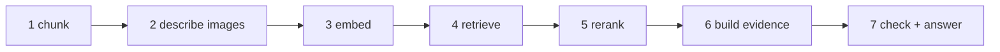
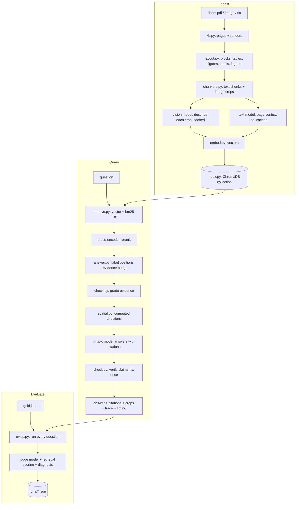

# RAG Works

**A framework for understanding, comparing and building Retrieval-Augmented Generation (RAG) systems, with a working multimodal reference implementation.**

RAG Works breaks RAG into seven stages, describes every RAG type by which stages it changes, and gives each type the same description card: what problem it solves, how it works, what it costs, how it fails and when to use it. The app is the reference implementation: a multimodal RAG chatbot where every stage is a switch. Flip a switch, ask a question, see exactly what was retrieved and why, then measure the change on a gold-standard question set.

| | |
|---|---|
| **Course** | ICS 499 Capstone, Metro State University, Fall 2026 |
| **Team** | RAGtag |
| **Author** | Patrick Duch |
| **Instructor** |  Siva Jasthi |
| **Stack** | Python 3.11+, Streamlit, ChromaDB, PyMuPDF, fastembed, rank-bm25, Gemini / Groq / Ollama |
| **License** | MIT |


## Contents

1. [Project scope](#1-project-scope)
2. [The framework](#2-the-framework)
3. [Features](#3-features)
4. [Tech stack](#4-tech-stack)
5. [Architecture](#5-architecture)
6. [Installation](#6-installation)
   - [Get a Gemini key](#6a-get-a-free-gemini-key)
   - [Get a Groq key](#6b-get-a-free-groq-key)
   - [Run locally with Ollama](#6c-run-locally-with-ollama-no-key-no-limits)
   - [Troubleshooting](#6d-troubleshooting)
7. [Workflows](#7-workflows)
8. [Evaluation methodology](#8-evaluation-methodology)
9. [Results](#9-results)
10. [Project history: FP1 to FP10](#10-project-history-fp1-to-fp10)
11. [Limitations and future work](#11-limitations-and-future-work)
12. [Repository structure](#12-repository-structure)
13. [Configuration reference](#13-configuration-reference)
14. [Acknowledgments and license](#14-acknowledgments-and-license)

---

## 1. Project scope

The scope set at the start of the semester, and where each part lives:

| Scope | How RAG Works meets it |
|---|---|
| Build a framework for understanding and implementing different types of RAG | RAG as seven stages with swappable switches. Every type is a combination of switches ([section 2](#2-the-framework)) |
| Identify and organize RAG architectures and approaches | A catalog of 13 RAG types in five groups: indexing, retrieval, post-retrieval, generation control, architecture |
| Describe and articulate each type's characteristics | Every type gets the same card: problem, how, cost, failure modes, when to use, status, measured result |
| Develop one or more reference implementations | One app implements 10 of the 13 types from a single codebase. The remaining three are described as future work |
| Demonstrate how the framework is used to understand, compare and build | The framework tab, retrieval trace, evals, compare view, and a five-step evaluation (`story.py`) that changes one stage at a time on the same questions |

Metro State University is the first test corpus (a campus map PDF plus four metrostate.edu pages), not the point. Any folder of PDFs, images or text files works as a knowledge base.

---

## 2. The framework

### Seven stages



| # | Stage | What it decides | Switches in the app |
|---|---|---|---|
| 1 | chunk | how documents become pieces: fixed text, pages, image regions, headings and tables, real figure boxes | chunking |
| 2 | describe images | how an image crop becomes searchable text: free prose, or every label plus where it sits | image descriptions |
| 3 | embed | which model turns text into vectors, and whether each chunk gets a line of page context first | embedding model, contextual chunks |
| 4 | retrieve | how candidates are found: by meaning (vector), exact words (BM25), or both fused | retrieval |
| 5 | rerank | whether a model that reads question and chunk together reorders the candidates | rerank |
| 6 | build evidence | what the model actually sees, plus facts code can work out (label positions, directions) | label positions, spatial facts, max images / text |
| 7 | check + answer | answer with citations, optionally grade the evidence first and verify the claims after | self-check, model |

### The catalog

| Group | Type | Status | Changes stages |
|---|---|---|---|
| indexing | Naive RAG | implemented | all (the baseline) |
| indexing | Multimodal RAG | implemented | chunk, describe |
| indexing | Structure-aware chunking | implemented | chunk, describe |
| indexing | Contextual retrieval | implemented | embed |
| retrieval | Sparse / keyword (BM25) | implemented | retrieve |
| retrieval | Hybrid (vector + BM25, rank fusion) | implemented | retrieve |
| post-retrieval | Reranked RAG | implemented | rerank |
| post-retrieval | Evidence-augmented RAG (label positions, spatial facts) | implemented | build evidence |
| generation control | Corrective RAG (grade, re-query, abstain) | implemented | check + answer |
| generation control | Self-verifying RAG (claim check + fix) | implemented | check + answer |
| architecture | Visual document retrieval (ColPali) | described | chunk, describe, embed, retrieve |
| architecture | GraphRAG | described | chunk, retrieve |
| architecture | Agentic RAG | described | retrieve, evidence, answer |

Every card, with problem, how, cost, failure modes and when to use it, is in **[docs/framework.md](docs/framework.md)** and in the app's **framework** tab. Both come from one file, `rag/framework.py`.

### Building a RAG system with the framework

Pick a value for each stage and you have built a RAG type. The app's framework tab shows the current switches on the pipeline and names the types they add up to. For example, `layout chunks + bge + hybrid + cross rerank + labels + spatial facts + check auto` is Multimodal + Structure-aware + Contextual + Hybrid + Reranked + Evidence-augmented + Corrective + Self-verifying RAG. Every type card has a **try** button that sets those switches for you.

---

## 3. Features

| Feature | What you get |
|---|---|
| **Chat with citations** | answers with numbered `[n]` citations, a "why" line, and the image crops that support the answer |
| **Retrieval trace** | every candidate's vector rank, BM25 rank, fused rank, how far the reranker moved it, its score, and whether it was sent to the model |
| **Time breakdown** | every answer shows our code's time per stage next to the model API's time |
| **Self-check** | confidence score, the list of claims checked (✓ / ✗), and the answer before it was corrected |
| **Framework tab** | the pipeline, the catalog of RAG types, measured before and after results per type, and the FP6 to FP10 chart |
| **Evals** | run the gold questions with one click: retrieval and answer scored separately, per-question diagnosis, editable grades |
| **Compare** | every saved run in one table, bar charts for up to four runs, answer score by question type |
| **Chunks** | every chunk drawn on its page (text, table, figure boxes), with the exact text that was embedded |
| **Test bed** | write gold questions, mark evidence on the page or by quote, and draft questions with AI |
| **Three model providers** | Gemini and Groq free tiers, or a local model through Ollama |
| **Bring your own key** | no key in `.env`? paste one into the app. It stays in memory only |


---

## 4. Tech stack

| Layer | Tool | Why |
|---|---|---|
| UI | **Streamlit** 1.67 | Python-only web UI, fast to iterate. Custom "Citrine" theme in `assets/citrine.css` and `.streamlit/config.toml` |
| Vector store | **ChromaDB** 1.5 (cosine) | local, file-based, no server. One collection per index configuration |
| PDF parsing | **PyMuPDF** 2.1 | page rendering, text blocks with fonts and positions, table finder, drawings for figure detection |
| Embeddings | **fastembed** 0.9 with `BAAI/bge-base-en-v1.5` | runs on CPU, 512-token input. Also `all-MiniLM-L6-v2` (baseline) and `gemini-embedding-001` |
| Keyword search | **rank-bm25** | BM25 scoring for exact terms |
| Reranker | fastembed cross-encoder `Xenova/ms-marco-MiniLM-L-6-v2` | local, about 250 ms for 10 candidates on CPU |
| LLMs | **Gemini** (`gemini-3.8-flash`), **Groq** (`qwen/qwen3.8-27b` vision, `openai/gpt-oss-20b` text), **Ollama** (`qwen3-vl:8b-instruct`) | all through one OpenAI-compatible client (`openai` 3.49, `groq` 1.7) |
| Charts | Altair, pandas | eval and compare charts |
| Images | Pillow | crops, previews, evidence boxes |

Everything except the model calls runs locally. Our own code takes about 260 ms per question (median), and most of that is the reranker.

---

## 5. Architecture

### System overview



### Modules

| File | Responsibility |
|---|---|
| `app.py` | the Streamlit app: top bar, documents, chat, trace, and the framework, evals, retrieval, chunks, test bed and compare views |
| `story.py` | the whole FP6 to FP10 evaluation in one command, writes `story_report.txt` |
| `cli.py` | everything from the terminal: ping, index, ask, eval, ladder, bench |
| `rag/config.py` | every setting in one place: chunkers, embedders, retrievers, rerankers, providers, prompts |
| `rag/framework.py` | the stages and the catalog of RAG types. `python -m rag.framework` writes `docs/framework.md` |
| `rag/kb.py` | knowledge bases are folders in `corpus/`. Turns pdf, image and text files into pages, with renders and thumbnails |
| `rag/layout.py` | PDF structure: text blocks with fonts, tables, figure boxes, captions, label positions, legend detection. Cached on disk |
| `rag/chunkers.py` | pages to chunks: fixed, structure (headings, tables, date records), image grids or layout figure boxes with 15% overlap |
| `rag/embed.py` | MiniLM, bge and Gemini embeddings |
| `rag/index.py` | chunks into Chroma, one collection per index key, staleness checks |
| `rag/retrieve.py` | vector, BM25, hybrid (reciprocal rank fusion, k=60), cross-encoder and model rerankers |
| `rag/answer.py` | retrieve, pick evidence within the provider's image and token budget, grade, answer, verify, cite |
| `rag/spatial.py` | finds the places a question names and computes directions between them from label positions |
| `rag/check.py` | evidence grader, claim verifier, confidence score |
| `rag/evals.py` | gold questions to recall@k, MRR, retrieval pass, judge grade, key facts, diagnosis, summaries |
| `rag/testbed.py` | gold question editing and AI drafting |
| `rag/llm.py` | one `chat()` for Gemini, Groq and Ollama. Retries on 429/5xx, shows the API's real error |
| `rag/timing.py` | splits every answer's time into our code vs the model API |

### Index keys

An index is named `chunker.embedder.descriptions[.ctx]`, for example `layout.bge.structured.ctx`. Each combination is its own Chroma collection, so several can exist side by side and be compared.

| Chunker | Text chunks | Image chunks | From |
|---|---|---|---|
| `text` | fixed 1000 / 200 overlap | none | FP2 |
| `page` | fixed | one per page | FP4 |
| `region` | fixed | 2x2 crops | FP5 |
| `region3` | fixed | 3x3 crops | FP6 |
| `structure` | headings, sections, tables as markdown, date records | 2x2 crops | FP7 |
| `layout` | structure | real figure and table boxes from the PDF, big figures split 2x2 with overlap | FP7, FP10 |

### Caching

| What | Where | Committed? |
|---|---|---|
| image descriptions, page context lines | `corpus/<kb>/cache/` (by file hash) | yes, so a fresh clone builds the sample index without vision calls |
| eval runs | `runs/<kb>/` | yes, they are the evidence behind every number |
| Chroma, page renders, crops, layout analysis | `data/` | no (gitignored, rebuilt on demand) |

---

## 6. Installation

### Requirements

- Python **3.11 or newer** ([python.org](https://www.python.org/downloads/), tick "Add python.exe to PATH" on Windows)
- About 1 GB of disk for packages and local models
- One way to run a model: a free Gemini key, a free Groq key, or Ollama with a GPU (8 GB+ VRAM)

### Quick setup

**Windows:** double-click `setup.bat`, then `run.bat`.
**Mac / Linux:** `bash setup.sh`, then `bash run.sh`.

The setup script makes a `.venv`, installs `requirements.txt`, and copies `.env.example` to `.env`. The app opens at `http://localhost:8501`.

### Manual setup

```
git clone https://github.com/pduch99/rag-works.git
cd rag-works
python -m venv .venv
.venv\Scripts\activate                  (mac / linux: source .venv/bin/activate)
pip install -r requirements.txt
copy .env.example .env                  (mac / linux: cp .env.example .env)
streamlit run app.py
```

You should see `(.venv)` at the start of your prompt before running anything. The first run downloads bge-base embeddings (about 210 MB) and the cross-encoder (about 80 MB) once.

Then: **build index** in the documents panel, and ask a question (or click a sample one).

### 6a. Get a free Gemini key

1. Go to [aistudio.google.com/apikey](https://aistudio.google.com/apikey) and sign in with a Google account.
2. Click **Create API key**. Pick or create a Google Cloud project when asked.
3. Copy the key.
4. Put it in `.env` as `GEMINI_API_KEY=...` and set `RAG_PROVIDER=gemini`, or paste it into the box the app shows when no key is set.
5. Check it: `python cli.py ping --provider gemini`.

Notes: free-tier data may be used by Google to improve its models. Google retires model names quickly. If you get a 404 saying a model is not found, set the current one in `.env` (`GEMINI_TEXT_MODEL`, `GEMINI_VISION_MODEL`). If the error says `limit: 0`, that model has no free quota on your account.

### 6b. Get a free Groq key

1. Go to [console.groq.com](https://console.groq.com) and sign up (Google or GitHub sign-in works).
2. Open **API Keys**, click **Create API Key**, give it a name.
3. Copy the key right away. It is only shown once.
4. Put it in `.env` as `GROQ_API_KEY=...` and set `RAG_PROVIDER=groq`, or paste it in the app.
5. Check it: `python cli.py ping --provider groq`.

Notes: Groq is very fast but its free tier has tight limits. The vision model allows 3 images and about 7,000 input tokens per request, and about 200,000 tokens per day. A full five-step evaluation with images can use up the daily vision budget, which resets the next day.

### 6c. Run locally with Ollama (no key, no limits)

Runs the model on your own GPU. Nothing leaves your machine and there are no rate limits. Tested on an NVIDIA RTX 3060 (12 GB): a full five-step evaluation (70 questions, about 250 model calls) took about 15 minutes.

**Hardware:** an NVIDIA GPU with 8 GB+ VRAM is recommended. The 8B vision model uses about 7.3 GB at a 12,288-token context. On CPU only it works, but each answer takes minutes.

**1. Install Ollama.** Download it from [ollama.com/download](https://ollama.com/download).

To install on another drive (Windows), set where models go **before** installing, then install from PowerShell:
```
mkdir D:\Ollama\models
setx OLLAMA_MODELS "D:\Ollama\models"
cd $HOME\Downloads
.\OllamaSetup.exe /DIR="D:\Ollama"
```
Open a new terminal afterwards. If `ollama` is "not recognized", add it to your PATH once:
```
[Environment]::SetEnvironmentVariable("Path", [Environment]::GetEnvironmentVariable("Path","User") + ";D:\Ollama", "User")
```
then close and reopen the terminal.

**2. Pull the model.** Use the **instruct** version. The default `qwen3-vl:8b` "thinks" out loud first, which is slower and eats the answer's token budget.
```
ollama pull qwen3-vl:8b-instruct
```

**3. Give it a bigger context.** Ollama defaults to a 4096-token context, and our requests with images need about 5,000. Bake a bigger context into a copy of the model (it shares the same files, no extra disk):
```
"FROM qwen3-vl:8b-instruct`nPARAMETER num_ctx 12288" | Out-File -Encoding ascii Modelfile
ollama create rag-vl -f Modelfile
```
(Mac / Linux: `printf 'FROM qwen3-vl:8b-instruct\nPARAMETER num_ctx 12288\n' > Modelfile`)

**4. Check it runs on the GPU.**
```
ollama run rag-vl "hi"
ollama ps
```
`PROCESSOR` should say `100% GPU` and `CONTEXT` should say `12288`. A CPU/GPU split means the model doesn't fit: use `qwen3-vl:4b-instruct` instead.

**5. Point RAG Works at it.** In `.env`:
```
RAG_PROVIDER=ollama
OLLAMA_VISION_MODEL=rag-vl
OLLAMA_TEXT_MODEL=rag-vl
EVAL_WORKERS=1
LLM_WORKERS=1
```
One worker at a time, because parallel calls on one GPU just fight over memory. Then:
```
python cli.py ping --provider ollama
streamlit run app.py
```

An 8B local model is much weaker than the cloud models. That is useful for the evaluation (it shows where small models break), but expect weaker answers than Gemini or Groq.

### 6d. Troubleshooting

| Symptom | Cause | Fix |
|---|---|---|
| `ModuleNotFoundError: No module named 'rank_bm25'` (or any package) | the virtual environment isn't active | `.venv\Scripts\activate` (you should see `(.venv)`), then run again |
| `ImportError: cannot import name ...` after updating | one file was updated and another wasn't | replace the whole `rag/` folder, not single files |
| `invalid choice: 'ollama'` | `rag/config.py` is an old version | update `rag/config.py` |
| `str expected, not NoneType` with ollama | `rag/llm.py` is an old version | update `rag/llm.py` |
| `ollama` is not recognized | Ollama isn't on your PATH | see step 1 of 6c, then open a new terminal |
| `request (5000 tokens) exceeds the available context size (4096 tokens)` | Ollama's default context is too small | step 3 of 6c (`num_ctx 12288`), check with `ollama ps` |
| answers are slow and start with "Thinking..." | the thinking version of the model | use `qwen3-vl:8b-instruct` |
| ollama `Connection error` | Ollama isn't running | open the Ollama app (tray icon), or run `ollama serve` |
| `429` / "rate limited, waiting" | free-tier per-minute limit | it waits and retries on its own. Lower `EVAL_WORKERS` |
| error mentions `per day` | free daily limit used up | wait for the reset, switch provider, or use Ollama |
| `limit: 0` | that model has no free quota on your key | set a different model name in `.env` |
| `404` / model not found | model name retired or misspelled | set the current name in `.env` |
| `503` / overloaded | the provider is busy | retried automatically. Try again in a few minutes |
| index shows "stale, rebuild" | documents or chunking code changed since the build | **rebuild index** in the documents panel |
| `story.py` stops at "api check" | the model API isn't answering | read the message it prints. It explains the common causes |
| GitHub shows broken images in this README | screenshots not added | save them to `docs/img/` |

---

## 7. Workflows

### Ask a question and read the trace

1. Pick a knowledge base and settings in the top bar. **build index** if the documents panel says there's none.
2. Ask in the chat, or click a sample question.
3. Read the answer: citations `[n]`, the "why" line, the supporting crops, the confidence chip.
4. In the **retrieval trace** (right): what was found, where vector and BM25 ranked it, how far the reranker moved it, and what was sent. The time bars show our code (amber) vs the model (teal).
5. The **retrieval** view (bottom) shows the exact prompt and raw model output.

### Explore the framework

1. Open the **framework** tab. The pipeline shows your current switches at each stage.
2. "this setup is" names the RAG types your switches add up to.
3. Filter the catalog by group. Each card has the same fields and, when measured, its before and after numbers.
4. Press **try** on a card to load its switches, then ask a question or run an eval.

### Add your own documents

1. Documents panel → **+ upload documents** → type a name under "make a new knowledge base" → **create**.
2. Pick it in the top bar, upload PDFs, images, `.txt` or `.md` files, **save to knowledge base**.
3. **build index**. The first build calls the vision model once per figure crop, and results are cached.

Knowledge bases are plain folders: `corpus/<name>/docs/`, `corpus/<name>/gold.json`, `corpus/<name>/cache/`.

### Write gold questions

1. **test bed** tab → **+ new question**.
2. Fill in the question, expected answer, key facts (short, one per line), type and split (dev or test).
3. Add evidence: tick the 3x3 cells where the answer is on the page, or paste an exact quote for text.
4. Or use **draft 3 questions with AI** and check every draft against the page before adding it.

### Run and compare evaluations

1. Choose a split in settings (`dev` while tuning, `test` once at the end) and press **run eval**.
2. **evals** tab: metric tiles vs the previous run, the by-type heatmap, and the per-question table with diagnosis.
3. Hand-check grades: change a grade, tick **checked**, **save grades**. The run then reports how often the judge agrees with you.
4. **compare** tab: every run in one table, and bar charts for up to four.

### Reproduce the results

```
python story.py --provider ollama          (or gemini / groq)
```

Builds the indexes it needs, runs five steps on the same 14 questions, asks four demo questions with full traces, times our code without model calls, and writes `story_report.txt`. Options: `--kb`, `--split`, `--skip-evals`, `--out`.

### Command line

```
python cli.py kbs                                                   list knowledge bases and indexes
python cli.py ping --provider groq                                  one tiny call, prints the API's real error
python cli.py index metrostate layout --embedder bge --style structured --contextual
python cli.py ask metrostate layout "Where is the parking ramp relative to the Student Center?" --contextual --retriever hybrid --reranker cross --spatial
python cli.py eval metrostate layout --contextual --retriever hybrid --reranker cross --check auto --spatial --split dev
python cli.py ladder metrostate fp8 --index layout.bge.structured.ctx
python cli.py bench metrostate layout --contextual --retriever hybrid --reranker cross
```

---

## 8. Evaluation methodology

### Gold questions

Each question in `corpus/<kb>/gold.json` has an id, type, split, expected answer, key facts, whether it's answerable, and its **evidence as a location**: `{doc, page, box}` for a region of a page, or `{doc, page, quote}` for exact text. Because evidence is a location rather than a chunk id, every chunking strategy is scored against the same truth.

The Metro State set has 14 questions: 8 about the campus map (location, spatial, route, detail), 5 about the text pages (facts and exact terms), and 1 that the documents can't answer.

### Metrics

| Metric | Meaning |
|---|---|
| recall@1 / @3 / @5 | share of the gold evidence covered by the top 1, 3, 5 hits |
| MRR | 1 / rank of the first relevant hit |
| retrieval pass | all gold evidence was actually sent to the model, not just retrieved |
| answer score | judge grade: correct = 1, partial = 0.5, wrong = 0 |
| grounded | the judge found the answer supported by the evidence that was sent |
| key facts | share of key facts that appear word for word in the answer (no model involved) |
| citation ok | the answer cites the document the gold evidence is in |
| hallucinated | answered an unanswerable question instead of saying it couldn't find it |
| false not-found | said "not found" on a question the documents do answer |
| corrected | answers the verifier changed |
| calls / question, our code ms, seconds | cost and speed |

### Diagnosis

Every question gets one label, so each miss says whose fault it was:
- `pass`
- `fail: retrieval`: the evidence never reached the model
- `fail: generation`: the right evidence was sent and the answer was still wrong
- `partial: ...` versions of both
- `pass: abstained` / `fail: hallucinated` for unanswerable questions
- `fail: abstained (evidence was sent)`

### The judge and its limits

Answers are graded by an LLM judge that sees the question, expected answer, key facts, the system's answer, and the same evidence the answer model saw (text, label positions, spatial facts). It can be wrong, so:
- grades can be overridden in the evals tab, and the **checked** column measures judge vs human agreement
- key facts is a second, model-free check
- on local runs the judge is the same model that answered, so spot-check before quoting

### One change at a time

`story.py` changes one stage per step and keeps everything else fixed (same questions, same model, same judge). The difference between two steps is the effect of that one stage. Use the `dev` split while tuning and report `test` once.

---

## 9. Results

All 14 Metro State questions, local `qwen3-vl:8b-instruct` for answering and judging, Nov 17 2026.

| | FP6 baseline | FP7 better index | FP8 hybrid + rerank | FP9 labels + self-check | FP10 spatial facts |
|---|---|---|---|---|---|
| stage changed | | indexing | retrieval | evidence + checks | evidence |
| retrieval pass | 0.77 | 0.92 | 0.92 | 0.92 | 0.92 |
| MRR | 0.72 | 0.81 | 0.84 | 0.84 | 0.84 |
| answer score | 0.68 | 0.57 | 0.54 | 0.61 | **0.64** |
| grounded | 0.93 | 0.71 | 0.71 | 0.86 | **0.93** |
| key facts | 0.59 | 0.51 | 0.56 | 0.56 | **0.63** |
| hallucinated | 0 | 0 | 0 | 0 | 0 |
| model calls / question | 2.0 | 2.0 | 2.0 | 3.6 | 3.5 |
| our code, ms / question | 325 | 56 | 309 | 282 | 262 |

### Findings

1. **Better retrieval made answers worse, on two different models.** FP7 raised retrieval pass from 0.77 to 0.92 while answer score fell (Groq's 27B model: 0.64 → 0.46, local 8B: 0.68 → 0.57).
2. **The fix was the evidence, not the search.** Reading failed traces found a map legend posing as a real label, a building cut by a crop seam, and image descriptions using a different coordinate frame than the label list. Fixing those, plus spatial facts, brought answers back to 0.64 and grounding back to 0.93.
3. **The bottleneck moved at each stage:** retrieval (FP2-FP6), then the evidence (FP7-FP9), then the model's own reasoning (FP10). Separate retrieval and generation scoring is what made each move visible.
4. **Code beats a small model at geometry.** Computing directions from label positions fixed a spatial question the model kept getting wrong.
5. **A small model can contradict a fact it was handed, and its own checker approves.** Given "the ramp is south-east of the Student Center", the 8B model answered "north-east", and its verifier (the same model) marked the claim correct. Self-checking only helps when the checker is stronger than the model it checks.
6. **No hallucinations in any step.** The unanswerable question was refused correctly every time.
7. **The program isn't the slow part.** Our code: about 260 ms per question, mostly the reranker. Everything else under 5 ms. The model takes 2 to 25 seconds.

Full write-up: [docs/fp10.md](docs/fp10.md). Earlier checkpoints: [docs/fp6.md](docs/fp6.md) to [docs/fp9.md](docs/fp9.md).


---

## 10. Project history: FP1 to FP10

| FP | Built | What it showed |
|---|---|---|
| 1 | scope: Python reference implementations of RAG patterns on Metro State data | users: students, prospective students, faculty, staff |
| 2 | **Naive RAG**: four metrostate.edu pages, 1000/200 chunks, Chroma, top 3 to a Groq model | "When is the registration deadline?" retrieved related chunks but answered with semester end dates. Related retrieval ≠ correct answer |
| 3 | **Multimodal RAG**: an image described by a vision model, the description indexed, the original image sent when retrieved. Explored LightRAG | uploading an image to a model is vision, not RAG. The image has to be retrieved first |
| 4 | **PDF image RAG** on the campus map: text-only vs multimodal on 8 fixed questions | text-only had the labels but not the layout. Multimodal answered spatial questions, sometimes confidently wrong |
| 5 | **Region-level retrieval**: the map cut into 2x2 crops, each described and indexed | retrieved the right NE and SE crops for the parking ramp question and still answered "north-west". Retrieval and generation must be scored separately. Hit Groq's image and token limits |
| 6 | one shared app: knowledge bases, switchable chunkers, citations, evidence selection within model limits, three-panel UI, gold questions, LLM judge, saved runs, Gemini support | every miss diagnosed as retrieval or generation |
| 7 | gold v2 (evidence by location), test bed editor, bge embeddings, structured descriptions, structure and layout chunking, contextual chunks, recall@k and MRR | retrieval 0.77 → 0.92, answers dropped |
| 8 | BM25, hybrid with reciprocal rank fusion, cross-encoder and model reranking, rank movement in the trace | hybrid fixed the exact-term question |
| 9 | label positions from the PDF, self-check modes (grade, verify, full, auto), confidence, hallucination and false not-found metrics, speed work (250 → 60 ms per click), API error handling | zero hallucinations. Groq's daily limit left runs incomplete |
| 10 | Ollama provider, five evidence fixes, spatial facts, the framework tab and catalog, setup scripts, bring-your-own-key, complete FP6-FP10 run | answers recovered to 0.64, grounding to 0.93. The remaining failures are the model's reasoning |

FP2-FP5 scripts are kept as they were in `legacy/`.

---

## 11. Limitations and future work

**Limitations**
- 14 gold questions on one map and four web pages. The FP10 evidence fixes were found by studying this map, so a wider test set is needed to show they generalize.
- Answer grades come from an LLM judge. On local runs it's the same model that answered.
- Label positions and spatial facts need a PDF text layer. Scanned maps fall back to image descriptions.
- Near-duplicate facts still trip retrieval ("Fall 2026 registration begins" vs "Fall 2026 OPEN (visiting students) registration begins").
- Free tiers change their models and limits often.

**Future work**
- the 10-PDF test bed and a held-out test-split run
- visual document retrieval (ColPali, e.g. `byaldi`), compared against description-based retrieval
- a stronger, separate judge model and more hand-checked grades
- RAGAS-style metrics alongside our own
- layout parsing with Docling or Marker for harder documents
- GraphRAG and agentic RAG as implemented types
- a hosted demo with saved answers for visitors without a key

---

## 12. Repository structure

```
rag-works/
  app.py                 Streamlit app
  story.py               full FP6 to FP10 evaluation
  cli.py                 command line
  rag/                   the core (see section 5)
  corpus/
    metrostate/          campus_map.pdf + 4 text pages, gold.json (14 questions), cache/
    testbed/             empty knowledge base for your own documents
  runs/                  saved eval runs (JSON)
  docs/
    framework.md         the catalog of RAG types (generated)
    fp6.md ... fp10.md   checkpoint write-ups
    rag-architecture-patterns.md   early RAG guide (FP1-FP2)
    DESIGN.md            the Citrine design system
    img/                 screenshots
  assets/citrine.css     app styling
  .streamlit/config.toml theme
  legacy/                FP2-FP5 scripts as they were
  setup.bat / setup.sh   one-time setup
  run.bat / run.sh       start the app
  requirements.txt
  .env.example           every setting, copy to .env
```

---

## 13. Configuration reference

All settings live in `.env` (copy `.env.example`). `.env` is gitignored, never commit it.

| Setting | Default | Meaning |
|---|---|---|
| `RAG_PROVIDER` | `gemini` | which provider the app starts on: `gemini`, `groq` or `ollama` |
| `GEMINI_API_KEY` | | Gemini key |
| `GEMINI_TEXT_MODEL` / `GEMINI_VISION_MODEL` | `gemini-3.8-flash` | Gemini model names |
| `GROQ_API_KEY` | | Groq key |
| `GROQ_TEXT_MODEL` | `openai/gpt-oss-20b` | Groq text model |
| `GROQ_VISION_MODEL` | `qwen/qwen3.8-27b` | Groq vision model |
| `OLLAMA_VISION_MODEL` / `OLLAMA_TEXT_MODEL` | `qwen3-vl:8b-instruct` | local model, `rag-vl` after step 3 of 6c |
| `OLLAMA_URL` | `http://localhost:11434/v1` | where Ollama listens |
| `RAG_EMBEDDER` | `bge` | `bge`, `minilm` or `gemini` |
| `EVAL_WORKERS` | `2` | questions evaluated in parallel (1 for Ollama) |
| `LLM_WORKERS` | `3` | parallel vision calls while building an index (1 for Ollama) |
| `RERANK_MAX` | `10` | candidates the cross-encoder reads |
| `RERANK_CHARS` | `600` | characters per candidate the cross-encoder reads |
| `CROP_OVERLAP` | `0.15` | overlap between split figure crops |
| `RECORD_CHUNK` | `500` | chunk size for date lists (calendars) |
| `CHUNK_SIZE` / `CHUNK_OVERLAP` | `1000` / `200` | fixed text chunks |
| `RENDER_PX` / `SEND_PX` | `3000` / `1600` | page render size, image size sent to the model |
| `RAG_PUBLIC` | | set to `1` when hosting for others: hides the paste-your-key box |

---

## 14. Acknowledgments and license

- [instructor name], for the project direction and weekly feedback
- The RAG Works and LLM RAG Evaluation reference repositories provided at the start of the project
- Metro State University public web pages and campus map, used as the test corpus
- Open-source projects this is built on: Streamlit, ChromaDB, PyMuPDF, fastembed (BAAI bge, MS MARCO cross-encoder), rank-bm25, Ollama, Qwen3-VL
- Ideas from: reciprocal rank fusion (Cormack et al., 2009), contextual retrieval (Anthropic, 2024), corrective RAG (Yan et al., 2024)

Released under the [MIT License](LICENSE).
